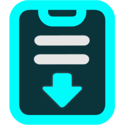

<p align="center">
  
</p>

## 📋 CyberPaste {{VERSION}}: Release Notes

### 🚀 What's new in this release

<!-- IMPORTANT FOR AGENTS & MAINTAINERS: Always rewrite this entire section with the ACTUAL release notes for this specific version before tagging. NEVER leave or copy previous version notes! Use 25-45 words, lead with user-facing changes, and do not repeat the app name or version. -->
<!-- changelog-summary:start -->
Single-key hotkeys to lock the app and pause monitoring, context-aware folder targets, a calmer steel-teal selection and window edge, a branded installer header with VirusTotal report links, and an evenly spaced compact header headline this release.
<!-- changelog-summary:end -->

> **New to CyberPaste?** A fast, privacy-first Windows clipboard manager with history, folders, OCR, and configurable AI actions.

---

### ✨ Key Features & Highlights

- ⌨️ **New Single-Key Hotkeys**:
  - **`Alt+L` locks the app now**: The titlebar padlock gets its own shortcut, working in Full Screen and Compact modes alike.
  - **`Ctrl+K` pauses clipboard monitoring**: Pause or resume capture instantly, with the state mirrored on the titlebar button.
  - **Discoverable everywhere**: Both shortcuts appear in the HUD hint cycle, the Compact footer hints, and their titlebar tooltips.

- 🖱️ **Context-Aware Folder Targets**:
  - **No wasted destinations**: The "Copy to folder" dialog hides the folder you are browsing.
  - **Bulk bar parity**: The main clipboard is only offered when browsing a folder, exactly like the bulk action bar.

- 🎨 **Quieter Selection & Window Edge**:
  - **Steel-teal selection**: The default theme's selected clip swaps neon cyan for a desaturated steel-teal across border, tint, and glow.
  - **Refined silver**: The monochrome dark theme gets a whisper-dimmer silver selection; the light theme is untouched.
  - **Calm window edge**: The compact window border trades neon for the same steel-teal, and the selected row's accent bar fades with a vertical gradient.

- 📦 **Installer Polish & VirusTotal Reports**:
  - **Branded header banner**: The installer header shows a dedicated 150x57 artwork instead of the distorted icon that default NSIS drew at scaled DPI.
  - **VirusTotal links**: Both artifacts link to their VirusTotal reports, submitted automatically by the release workflow.
  - **Even header rhythm**: Folder pills share the search bar's exact height, so the search-to-folders and folders-to-clips gaps match.
  - **40% saturation tray logo**: The tray menu logo idles with a hint of color instead of full grayscale.

- 🧹 **Cleaner More Menu**:
  - **No duplicated actions**: "Lock now" and "Pause monitoring" left the More menu since both have visible titlebar buttons with real hotkeys.

- ⚡ **Performance**:
  - **Stable vendor chunks**: The bundle splits into React, motion, i18n, and vendor chunks, so app updates no longer invalidate the third-party cache.

<details>
<summary><b>🇪🇸 Ver notas de la versión en Español</b></summary>

<!-- Maintainer: Traduce el resumen y los puntos clave de arriba al español en cada release. -->

### 🚀 Novedades de esta versión

Atajos de una tecla para bloquear la app y pausar el monitoreo, destinos de carpeta contextuales, una selección y ventana en teal acero más serenos, un encabezado de instalador con marca y enlaces a VirusTotal, y un header compacto con ritmo parejo encabezan esta versión.

> **¿Nuevo en CyberPaste?** Un gestor de portapapeles rápido y privado para Windows, con historial, carpetas, OCR y acciones de IA configurables.

---

### ✨ Novedades destacadas

- ⌨️ **Nuevos atajos de una tecla**:
  - **`Alt+L` bloquea la app ahora**: El candado de la titlebar tiene su propio atajo, en Modo Pantalla Completa y Compacto por igual.
  - **`Ctrl+K` pausa el monitoreo del portapapeles**: Pausa o reanuda la captura al instante, con el estado reflejado en el botón de la titlebar.
  - **Descubribles en todos lados**: Ambos atajos aparecen en el ciclo de hints del HUD, en los hints del footer compacto y en los tooltips de la titlebar.

- 🖱️ **Destinos de carpeta contextuales**:
  - **Sin destinos en vano**: El diálogo "Copiar a carpeta" oculta la carpeta en la que estás.
  - **Paridad con la barra masiva**: El portapapeles principal solo se ofrece cuando navegas una carpeta, igual que en la barra de acciones en masa.

- 🎨 **Selección y borde de ventana más serenos**:
  - **Selección teal acero**: El clip seleccionado del tema default cambia el cian neón por un teal acero desaturado en borde, tinte y glow.
  - **Plata refinada**: El tema oscuro monocromo estrena una plata apenas más discreta; el tema claro queda intacto.
  - **Borde de ventana tranquilo**: El borde de la ventana compacta cambia el neón por el mismo teal acero, y la barra de acento de la fila seleccionada se desvanece con un degradado vertical.

- 📦 **Instalador con marca y reportes de VirusTotal**:
  - **Banner de encabezado con marca**: El instalador muestra un arte dedicado de 150x57 en lugar del icono distorsionado que el NSIS por defecto dibujaba con DPI escalado.
  - **Enlaces a VirusTotal**: Ambos artefactos enlazan a sus reportes de VirusTotal, enviados automáticamente por el workflow de release.
  - **Ritmo parejo del header**: Las pills de carpeta comparten la altura exacta del buscador, así el gap buscador→carpetas coincide con el de carpetas→clips.
  - **Logo del tray al 40% de saturación**: El logo del menú del tray reposa con un toque de color en vez de escala de grises total.

- 🧹 **Menú More más limpio**:
  - **Sin acciones duplicadas**: "Bloquear ahora" y "Pausar monitoreo" salieron del menú More porque ambos tienen botón visible en la titlebar con atajo real.

- ⚡ **Rendimiento**:
  - **Chunks de vendor estables**: El bundle se divide en chunks de React, motion, i18n y vendor, así las actualizaciones de la app ya no invalidan la caché de terceros.


---

### 📦 Downloads & Packages

> ⬇️ **Direct download:** click a file name to download it now. Same files as in **Assets** at the bottom of this page.

| File | Description | Platform |
| :--- | :--- | :--- |
| **[`CyberPaste_{{VERSION_NUM}}_x64-setup.exe`](https://github.com/CyberGems/CyberPaste/releases/download/{{VERSION}}/CyberPaste_{{VERSION_NUM}}_x64-setup.exe)** | 🚀 **Recommended Installer** (NSIS Setup with Start Menu, Desktop & Startup options) | Windows 10 / 11 (x64) |
| **[`CyberPaste_{{VERSION_NUM}}_x64-portable.zip`](https://github.com/CyberGems/CyberPaste/releases/download/{{VERSION}}/CyberPaste_{{VERSION_NUM}}_x64-portable.zip)** | 📦 **Portable Build** (no installation; shares the user profile with the installed version) | Windows 10 / 11 (x64) |

---

### 🔐 VirusTotal and SHA256

> 🛡️ The report opens on VirusTotal in a new tab and does not download anything.

**Installer**: [View VirusTotal report](https://www.virustotal.com/gui/file/{{INSTALLER_HASH}})

```text
{{INSTALLER_HASH}}
```

**Portable edition**: [View VirusTotal report](https://www.virustotal.com/gui/file/{{PORTABLE_HASH}})

```text
{{PORTABLE_HASH}}
```
{{MSI_BLOCK}}
---

*Crafted with precision by [CyberGems](https://cybergems.org)*
