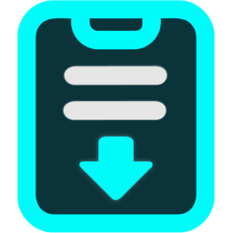

<p align="center">
  
</p>

## 📋 CyberPaste {{VERSION}}: Release Notes

### 🚀 What's new in this release

<!-- IMPORTANT FOR AGENTS & MAINTAINERS: Always rewrite this entire section and highlights with the ACTUAL release notes for this specific new version before tagging. NEVER leave or copy previous version notes! Use 25-45 words for the summary, lead with user-facing changes, and do not repeat the app name or version. Keep the Spanish mirror inside the details block in sync: translate the summary and rewrite the highlights. -->
<!-- changelog-summary:start -->
Tightens the horizontal gap between the system tray menu card and its side-by-side flyout panels so submenus sit closer and transition more naturally under pointer hover without changing keyboard navigation or screen-edge placement.
<!-- changelog-summary:end -->

> **New to CyberPaste?** A fast, privacy-first Windows clipboard manager with history, folders, OCR, and optional AI actions.

---

### ✨ Key Features & Highlights

- 🪟 **Closer tray flyout alignment**: Reduced the gap between the main tray card and its side-by-side flyout panels (`Pause notifications`, `Help`, and `More from CyberGems`) from `8px` to `4px`, updating the tray canvas geometry so hover transitions and visual grouping feel tighter.

<details>
<summary><b>🇪🇸 Ver notas de la versión en Español</b></summary>

### 🚀 Novedades de esta versión

Reduce la separación horizontal entre la tarjeta del menú de bandeja y sus paneles flyout laterales para que los submenús aparezcan más cerca y el paso del cursor resulte más natural, manteniendo la navegación con teclado y el ajuste automático a pantalla.

> **¿Nuevo en CyberPaste?** Un gestor de portapapeles rápido y privado para Windows, con historial, carpetas, OCR y acciones de IA opcionales.

---

### ✨ Novedades destacadas

- 🪟 **Submenús flyout más próximos**: Se redujo de `8px` a `4px` el espacio entre el menú principal de la bandeja y los paneles laterales (`Pausar notificaciones`, `Ayuda` y `Más de CyberGems`), ajustando el ancho del lienzo para que se integren con mayor cohesión visual.

### ℹ️ Antes de instalar

- **Windows:** esta versión aún no está firmada digitalmente. SmartScreen puede avisar antes de ejecutarla: **Más información › Ejecutar de todas formas**. Cuando Smart App Control está activado, Windows rechaza programas sin firmar; consulta la [política de firma de código](https://github.com/CyberGems/.github/blob/main/CODE_SIGNING.md). Verifica la descarga con los checksums SHA256 que aparecen más abajo.

</details>

---

### ℹ️ Before you install

- **Windows:** this release is not code-signed yet. SmartScreen may ask before it runs: **More info › Run anyway**. Where Smart App Control is on, Windows refuses unsigned programs; see the [code signing policy](https://github.com/CyberGems/.github/blob/main/CODE_SIGNING.md). Verify the download with the SHA256 checksums below.

---

### 📦 Downloads & Packages

> ⬇️ **Direct download:** click a file name to download it now. Same files as in **Assets** at the bottom of this page.

| File | Description | Platform |
| :--- | :--- | :--- |
| **[`CyberPaste_{{VERSION_NUM}}_x64-setup.exe`](https://github.com/CyberGems/CyberPaste/releases/download/{{VERSION}}/CyberPaste_{{VERSION_NUM}}_x64-setup.exe)** | 🚀 **Recommended Installer** (NSIS Setup with Start Menu, Desktop & Startup options) | Windows 10 / 11 (x64) |
| **[`CyberPaste_{{VERSION_NUM}}_x64-portable.zip`](https://github.com/CyberGems/CyberPaste/releases/download/{{VERSION}}/CyberPaste_{{VERSION_NUM}}_x64-portable.zip)** | 📦 **Portable Build** (no installation; shares the user profile with the installed version) | Windows 10 / 11 (x64) |

---

### 🔐 VirusTotal and SHA256

> 🛡️ The report opens on VirusTotal and does not download anything.

**Installer**: [View VirusTotal report](https://www.virustotal.com/gui/file/{{INSTALLER_HASH}})

```text
{{INSTALLER_HASH}}
```

**Portable**: [View VirusTotal report](https://www.virustotal.com/gui/file/{{PORTABLE_HASH}})

```text
{{PORTABLE_HASH}}
```
{{MSI_BLOCK}}
---

📜 **Full changelog:** browse every version in [CHANGELOG.md](https://github.com/CyberGems/CyberPaste/blob/main/CHANGELOG.md).

*Crafted with precision by [CyberGems](https://cybergems.org)*
